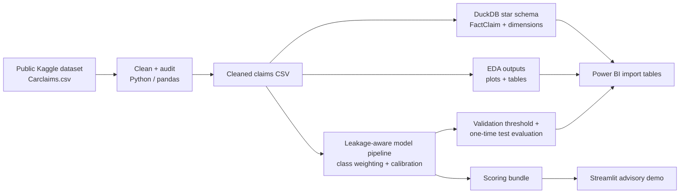

# Insurance Claims Intelligence & Fraud Risk Prediction

An end-to-end portfolio project for insurance claims analytics and data-science interviews. It combines a documented public dataset, a DuckDB star schema and analytical SQL, reproducible Python cleaning and EDA, a leakage-aware imbalanced-classification workflow, Power BI specifications, and a Streamlit scoring demo.

**Scope:** the model estimates the probability of the dataset's recorded positive label. It does not determine that a real claim is fraudulent, and it is not suitable for claim denial, payment decisions, or production use. Scores are for a human-review demonstration only.

## Project architecture



## Dataset, provenance, and limitations

The project uses the **Vehicle Insurance Claim Fraud Detection** dataset, distributed as `Carclaims.csv` (some mirrors call it `fraud_oracle.csv`): approximately 15,420 historical vehicle-claim records, 33 columns, and about 923 rows marked positive (roughly 6%). Download it from [Kaggle](https://www.kaggle.com/datasets/khusheekapoor/vehicle-insurance-fraud-detection) or use the [public GitHub CSV mirror](https://github.com/Rashmi-77/Vehicle-Insurance-Fraud-Detection/blob/main/carclaims.csv). A systematic literature review cites the Kaggle file as `Carclaims.csv` from Angoss Knowledge Seeker; related work describes an Oracle-origin vehicle-insurance benchmark of similar size. The exact file-level chain of custody is not documented ([systematic review](https://doi.org/10.1016/j.iswa.2024.200340); [Chawda, Grimm & Kloft, 2022](https://arxiv.org/abs/2210.14056)).

The public record does not provide an audit trail for how each label was investigated or adjudicated, and accessible copies sometimes differ by one row or header/index artifacts. The `FraudFound_P` field is therefore treated as a **recorded benchmark label**, not verified fraud ground truth. Available descriptions place the data in an older historical context; it is small, dated, U.S.-oriented, and not representative of a current insurer's portfolio, controls, or class prevalence. No employer or customer data is used. Raw data is excluded from Git.

Download the CSV from either source into `data/raw/` as `carclaims.csv` or `fraud_oracle.csv`. On GitHub, open the CSV page and choose **Download raw file**. The prep script also accepts a single CSV under another name. Review the source's terms before redistribution; this repository does not redistribute the dataset.

### Data caveats handled explicitly

- Positive labels are rare; accuracy is not used as the main model-selection metric.
- The source is a single flat extract rather than claims, policy, customer, and investigation event tables. Dimension tables are analytical modeling conveniences, not recovered source-system entities.
- `PolicyNumber` and `RepNumber` are excluded from predictors as identifiers or operational proxies. Sex, age, age band, and marital status are also excluded from the predictive feature set; they remain in the analytical extract only for carefully qualified descriptive checks.
- Some fields (for example, police-report status and supplements) may be captured after initial notice. The demo is a retrospective triage exercise using the available record, not a first-notice-of-loss model.
- The dataset does not contain claim payment amounts, investigation costs, resolution times, or adjudication dates. No dollar savings, operational SLA, or real-world fraud lift is estimated.
- A random stratified holdout is used because the source does not document a trustworthy event-time and label-finalization timeline. It avoids fitting transformations on validation/test data, but it does not establish performance on future cohorts or unseen entities.

## Repository layout

```text
.
├── data/
│   ├── raw/                 # local download only; ignored by Git
│   ├── processed/           # cleaned CSVs and Power BI extracts; ignored
│   └── warehouse/           # local DuckDB file; ignored
├── docs/                    # data provenance and field notes
├── models/                  # local model and metrics; ignored
├── powerbi/                 # dashboard specification and DAX measures
├── reports/                 # generated EDA/model outputs; ignored
├── scripts/                 # command-line pipeline steps
├── sql/                     # star schema and analytical SQL
├── src/insurance_claims/    # reusable cleaning, features, modeling
├── streamlit_app.py         # local advisory scoring demo
├── tests/                   # focused unit tests with toy data
├── pyproject.toml
└── requirements.txt
```

## Setup and run

Use Python 3.12. From the repository root:

```powershell
py -3.12 -m venv .venv
.\.venv\Scripts\Activate.ps1
python -m pip install --upgrade pip
pip install -r requirements.txt
pip install -e .
```

Download the CSV from Kaggle or the GitHub mirror and save it as `data/raw/carclaims.csv` or `data/raw/fraud_oracle.csv`. If using the Kaggle CLI, configure its credential file locally, then run:

```powershell
kaggle datasets download -d khusheekapoor/vehicle-insurance-fraud-detection -p data/raw --unzip
```

Run the pipeline in order:

```powershell
python scripts/prepare_data.py
python scripts/run_eda.py
python scripts/build_warehouse.py
python scripts/train_model.py --min-recall 0.60
streamlit run streamlit_app.py
```

The data prep step writes `data/processed/claims_clean.csv` and an audit summary. EDA outputs go to `reports/figures/` and `reports/generated/`. DuckDB tables and Power BI CSV extracts are built from the cleaned data. Training writes a calibrated model, an explicit validation-selected review threshold, holdout predictions, and metrics to `models/` and `data/processed/powerbi/`.

### Tests

The focused tests use tiny synthetic fixtures, so they do not require the public dataset:

```powershell
pytest
```

## Modeling protocol

1. Normalize headers, missing-value sentinels, target labels, and known numeric fields; retain an audit summary.
2. Engineer calendar-cycle features from month names. Do not construct claim amounts, customer histories, or post-outcome data that the source does not contain.
3. Exclude identifiers and selected demographic fields from predictors. Fit missing-value imputation, scaling, and one-hot encoding inside each scikit-learn pipeline fold.
4. Split once into stratified train/validation/test partitions. Compare class-weighted logistic regression and random forest with cross-validated Average Precision on train only.
5. Calibrate the selected estimator with sigmoid calibration using training folds. Choose the decision threshold on validation probabilities to maximize precision subject to a configurable minimum recall (default 60%).
6. Report the test set once at that frozen threshold: precision, recall, F1, specificity, confusion counts, Average Precision, trapezoidal PR-AUC, ROC-AUC, Brier score, and calibration-curve data.

The minimum-recall target is an example operating assumption, not an insurer policy. Change it only with an explicit review-capacity and miss-cost rationale. Calibration and ranking metrics on this historical sample do not guarantee calibrated probabilities in another population.

### Baseline run on the public CSV

The included local run selected the random forest (five-fold training Average Precision 0.2207 versus 0.1690 for logistic regression). The data was split into 9,252 train, 3,084 validation, and 3,084 untouched test rows. At the validation-selected threshold of 0.0825, validation recall was 63.8% and precision was 17.5%. On the test partition, results against the **recorded source label** were:

| Test metric | Result |
|---|---:|
| Precision | 17.9% |
| Recall | 64.9% |
| F1 | 0.281 |
| Average Precision | 0.193 |
| Trapezoidal PR-AUC | 0.190 |
| ROC-AUC | 0.825 |
| Brier score | 0.0524 |
| Confusion counts (TP / FP / TN / FN) | 120 / 549 / 2,350 / 65 |

At this threshold, 669 of 3,084 holdout records (21.7%) would enter the example review queue. Precision is low: most queued records did not carry the dataset's positive label. This illustrates why threshold selection must account for review capacity and false-positive cost. These are results from one random split of a small historical benchmark, not estimates of performance at a current insurer.

## SQL and Power BI

`sql/schema.sql` creates `DimIncident`, `DimPolicy`, `DimVehicle`, `DimClaimant`, and `FactClaim`. `sql/analytics.sql` contains reusable workload, label-rate, segment, and data-quality queries. `scripts/build_warehouse.py` exports each modeled table as CSV for Power BI and stores the full local database in DuckDB. Training also exports a small-cell-aware descriptive test-split audit by excluded demographic groups; it is not a fairness certification.

Power BI does not require a `.pbix` to be delivered with this source project. Build instructions, page layout, slicers, labeling guidance, and ready-to-paste DAX are in [`powerbi/dashboard_spec.md`](powerbi/dashboard_spec.md) and [`powerbi/measures.dax`](powerbi/measures.dax). Keep the source-label rate and holdout model performance visually distinct. Do not present recorded-positive segments as causal fraud drivers.

## Interview-ready resume bullets

Use only after running the pipeline, and replace bracketed values with the generated holdout results:

- Built a reproducible insurance-claims analytics workflow in Python, DuckDB, and Power BI, including data-quality checks, a dimensional claims model, and segment-level analysis of a public vehicle-insurance benchmark.
- Developed leakage-aware, class-weighted scikit-learn pipelines with cross-validated model selection, sigmoid calibration, and validation-based threshold selection; reported holdout precision, recall, Average Precision, PR-AUC, and Brier score against the dataset's recorded label.
- Created a Streamlit demonstration that converts user-entered benchmark-style claim attributes into an advisory review-priority score, with explicit data and model limitations.

Quantified example from this run: “On a 3,084-record holdout from a public historical vehicle-insurance benchmark, reached **64.9% recall**, **17.9% precision**, and **0.193 Average Precision** against the dataset's recorded label at a validation-selected threshold targeting at least 60% recall.” Re-run the pipeline before using these figures in a resume, and do not claim fraud prevented, savings generated, or production readiness.

## Sources

- [Kaggle dataset page](https://www.kaggle.com/datasets/khusheekapoor/vehicle-insurance-fraud-detection)
- [GitHub CSV mirror](https://github.com/Rashmi-77/Vehicle-Insurance-Fraud-Detection/blob/main/carclaims.csv)
- [Chawda, Grimm & Kloft (2022), benchmark description](https://arxiv.org/abs/2210.14056)
- [Systematic literature review citing the Angoss Knowledge Seeker `Carclaims.csv` Kaggle file](https://doi.org/10.1016/j.iswa.2024.200340)
- [Scikit-learn calibration guide](https://scikit-learn.org/stable/modules/calibration.html)
- [Scikit-learn precision-recall metrics](https://scikit-learn.org/stable/modules/model_evaluation.html#precision-recall-f-measure-metrics)

